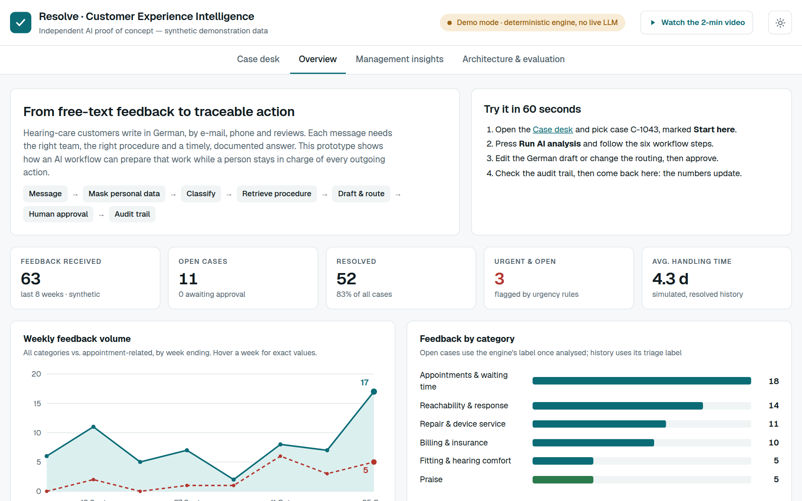
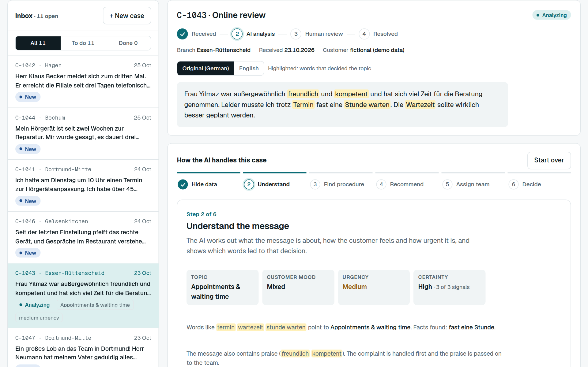
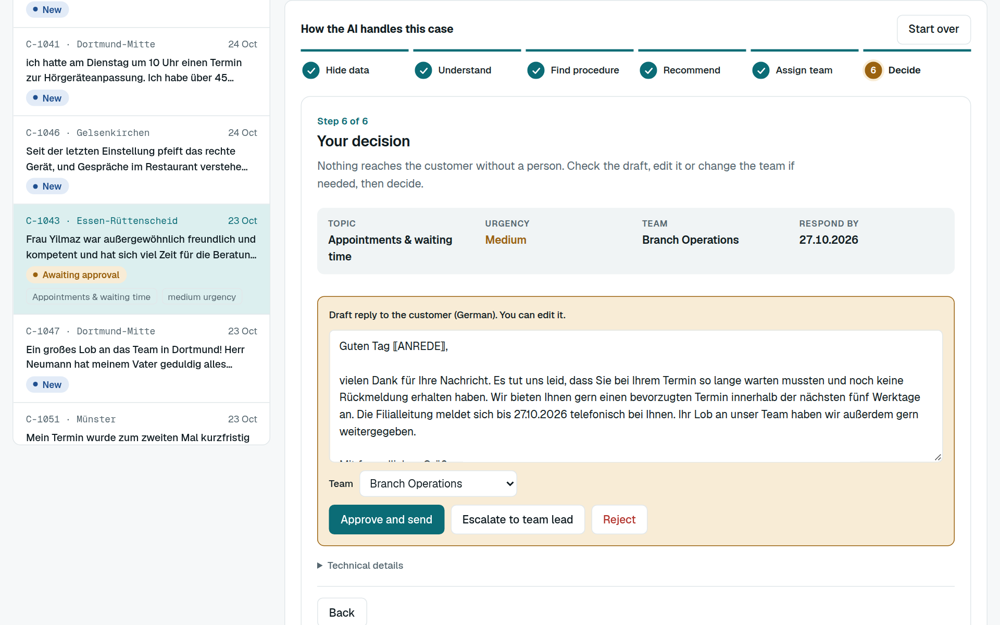

# Resolve · Customer Experience Intelligence

**Independent AI proof of concept: German customer feedback turned into approved, traceable actions.**

**Live demo:** https://youssefdhouib.github.io/cx-demo/
**Video walkthrough (1:44):** [resolve-demo-video.mp4](resolve-demo-video.mp4)

> Synthetic demonstration data only. Not affiliated with, endorsed by or connected to any company. The demo runs a deterministic rule-based engine in the browser; it does not call a language model. The video narration is an AI-generated voice.



## What it shows

A hearing-care retail scenario in Germany. A customer message (in German) goes through six steps, one at a time:

1. **Hide personal data:** names, phone numbers, e-mail addresses and customer numbers are masked before analysis.
2. **Understand the message:** topic, customer mood, urgency and certainty, with the words that led to the decision highlighted.
3. **Find the right procedure:** retrieval over a small library of fictional company procedures, with the cited source.
4. **Recommend next actions:** concrete actions and a German draft reply. The engine cannot send or change anything by itself.
5. **Send to the right team:** department, priority and a respond-by date from the procedure.
6. **Human decision:** a reviewer edits the draft, can change the team, then approves, escalates or rejects. Every step is written to an audit trail.





It also includes management insights computed from the demo records (for example, appointment-related complaints rising) and an **evaluation harness** that reports accuracy, macro-F1, routing accuracy and procedure-citation rate on an in-sample set and a 12-message held-out set. The rule engine reaches about 42% on the held-out wording, which is the gap the full LLM version is meant to close.

## Planned full version

| Layer | Technology |
|---|---|
| UI | Next.js, TypeScript |
| API | FastAPI with typed contracts, authentication, audit log |
| Workflow | LangGraph: mask → classify → retrieve → draft → route → human-review interrupt with checkpointer |
| Model | Configurable LLM provider, Pydantic-validated structured output, rule-based fallback |
| Retrieval | Embedding search over approved procedure documents, with citations |
| Data | PostgreSQL for cases and audit trail; export to existing BI dashboards |

## Run it locally

It is a single static page. Open `index.html` in a browser, or serve the folder:

```bash
python3 -m http.server 8000
```

Then open http://localhost:8000.

## Author

**Youssef Dhouib**, final-year Software Engineering student (AI Engineering), ISIMS, Tunisia.
GitHub: [github.com/youssefdhouib](https://github.com/youssefdhouib) · LinkedIn: [linkedin.com/in/youssef-dhouib-yd2003](https://linkedin.com/in/youssef-dhouib-yd2003)
